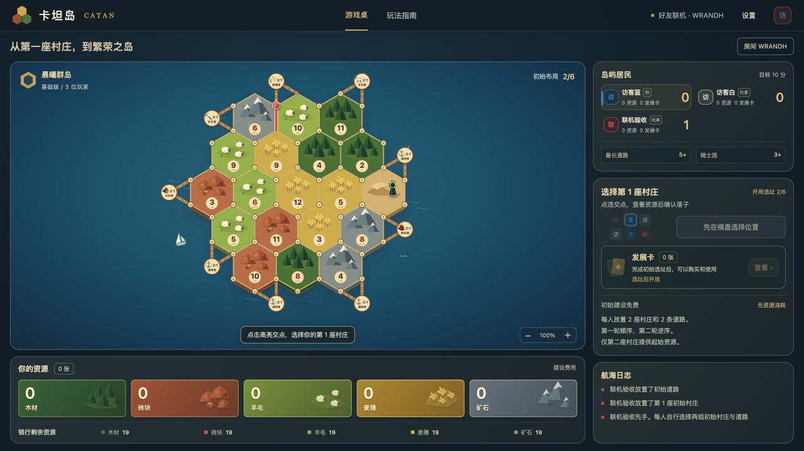

# 卡坦岛 · CATAN

参考卡坦岛基础版规则的本地海岛策略游戏，支持一位玩家与两位或三位 AI 对战，以及 3–4 个独立窗口开房联机。界面、矢量地形、棋子和图标均为原创 HTML、CSS、JavaScript 与 SVG，无第三方运行依赖。深蓝海面、森林绿、麦田金与暖陶色构成新的桌游配色。

## 在线联机

入口：<https://islands-table-zxy.zsj2957310036.chatgpt.site/online/>。

创建房间后复制邀请链接发给朋友。朋友输入名字加入，所有玩家准备后，由房主开始 3 人或 4 人对局。入口无需注册，房间没有公开列表；邀请链接只带房间码，不包含座位凭证。

在线对局使用云端共享数据库保存，规则校验、随机事件和隐藏手牌均在服务端执行。各客户端约每秒同步一次；同时提交的操作通过数据库版本比较避免覆盖或重复结算。关闭页面后，同一设备和浏览器可通过邀请链接里的「继续原座位」回到对局。清理浏览器站点数据会移除本设备的座位凭证。房间无操作 7 天后过期。

## 本地运行

本地开发需要 Node.js 22.13 或以上版本，无需安装依赖。在本目录执行 `npm run dev`。

- 人机棋桌：`http://127.0.0.1:4173/`。
- 好友房间：`http://127.0.0.1:4173/online/`，也可点击人机棋桌上的「好友联机」。

输入名字创建 3 人或 4 人房间，通过「打开新窗口加入试玩」打开另外的独立窗口。每个窗口输入自己的名字并加入，所有玩家准备后，房主点击「开始对局」。房主先手，各自选择两组初始村庄与道路。每个标签页标题都会显示玩家名字，便于切换。

本地服务默认只监听本机 `127.0.0.1`，用于本机多窗口试玩；邀请外地朋友时使用上面的在线入口。可通过 `PORT=4174 npm run dev` 改端口。纯静态运行仍可人机对战，但联机需要上述 Node 服务。

规则及联机测试：`npm test`。

## 本地联机

- 本机服务是唯一规则执行方；校验当前玩家、合法操作和局面版本，统一结算骰子、产出、交易、强盗、发展卡和胜利。
- 每个窗口使用独立的 `sessionStorage` 座位凭证，并在本设备保存可手动恢复的座位记录。邀请链接只含房间码；每位玩家只收到自己的资源明细和发展卡，对手只显示公开数量。
- 服务通过 HTTP 事件流推送局面，操作通过请求提交。网络中断会自动重连，刷新后恢复原座位；本机服务重启后从 `.catan-rooms/` 恢复对局。此目录包含私密存档，已从版本控制和交付压缩包中排除。
- 使用页面里的新窗口链接加入其他座位。直接复制一个正在对战的标签页，浏览器可能复制原座位身份。关闭窗口后可重新打开邀请链接，从本设备记录中手动选择原座位。
- 人机存档继续使用原来的浏览器存储键，联机不会覆盖它。教学在独立的人机棋桌中进行。

事件流采用浏览器原生能力，参见 [MDN 的服务器推送事件说明](https://developer.mozilla.org/en-US/docs/Web/API/Server-sent_events/Using_server-sent_events)；本机 HTTP 服务使用 [Node.js 内置 HTTP 模块](https://nodejs.org/api/http.html)。

## 基础玩法

- 3 人或 4 人对局，可随机先手或指定先手。19 块随机地形、54 个交点、72 条边；6 和 8 不相邻；9 个沿海港口。
- 空棋盘开始，每人自行放置两组村庄与相邻道路，先顺序、再逆序。初始建设免费，只有第二座村庄提供起始资源。
- 每种资源共 19 张，生产、消费、银行兑换和弃置均核对库存；银行不足以满足多位居民时，该类资源不发；只有一位居民应得时领取剩余数量。
- 道路连接、村庄距离、城市升级与 15 道路 / 5 村庄 / 4 城市的棋子上限；最长道路计算包含分支、环路和对手建筑的阻断。
- 银行 4:1、通用港口 3:1、专用港口 2:1，支持批量兑换。两段木板码头分别从可使用港口的两个海岸交点伸向海面，沿原连接线组成 V 形，汇合处的标牌正向显示资源图标、名称和兑换比率，可点击查看说明。居民之间可以用多种资源组合报价、拒绝、还价和接受，交易必须包含当前回合玩家。
- 可选择行动阶段自由交建，或经典的先交易、后建设顺序。
- 七点事件先让所有超过 7 张资源的居民弃置一半（向下取整），再移动强盗、选择相邻对手并随机偷取资源。空手邻居也可选择；骑士不触发弃牌。
- 25 张发展卡：14 骑士、5 胜利点、2 道路建设、2 丰收、2 垄断。已有卡可在掷骰前使用，结算后继续掷骰；每回合至多使用一张，新购卡次回合可用。胜利点隐藏计分，不受此限制。
- 道路建设卡连续结算免费道路，不可夹入交易或其他建设；没有合法道路或用完棋子时提前结束。丰收选择不超过银行库存，银行总量不足两张时领取可用数量。
- 最长道路与最大骑士团各 2 分，平局保留现持有者；在自己的回合达到 10 分立即获胜，包括掷骰前、购买胜利点牌后和第一条免费道路结算后。
- AI 通过独立的公开信息视图决策，只知道自己的手牌和发展卡，以及对手的资源总数、发展卡张数、公开分数与棋盘；无法读取对手资源构成、隐藏胜利点或牌堆顺序。系统会在玩家本地自动婉拒其无法支付的报价，不弹窗打断，也不会把无法支付的原因写入公共日志。
- 顶部「入门教学」提供八个独立主题：基础开局、强盗与七点、购买发展卡、骑士与最大骑士团、道路建设、丰收、垄断和胜利点。每一步高亮实际操作目标，配简短文字；中途刷新可继续，退出或完成后恢复原对局。
- 发展卡集中在骰子旁的回合操作区，直接显示持有张数、可用状态和购买材料；可使用时高亮，点击即可购买或使用。
- 交易报价与还价窗口在操作按钮上方显示「我的资源」，以资源图标和数量帮助判断交换；建设按钮直接逐枚显示材料图标，例如城市为两枚麦穗和三枚矿石；已拥有的材料亮起，缺少的逐枚变暗，交易或消耗资源后同步更新。
- 对局按窗口高度自动排布：桌面将棋盘与资源放在左侧、玩家和回合操作放在右侧；较窄的高窗口采用纵向棋桌和横向玩家栏。笔记本尺寸可在一屏看到棋盘、资源、发展卡、建设及交易，点击下方航海日志卡片任意位置可展开完整记录。手机和极小窗口保留可滚动布局，保证按钮与文字的大小。
- 棋盘选择统一采用暖金色高亮：道路沿边线显示，村庄交点用圆环，村庄预览和城市升级沿棋子轮廓描边；鼠标与键盘操作均使用实际形状提示。
- 本机自动存档、规则指南、建设费用表、完整日志、缩放、键盘操作和可关闭动效。

当前不包含扩展版、账号系统或公开匹配大厅。此项目是独立实现，并非官方产品。人机对局保存在当前浏览器，清理站点数据会清除它；房间对局由本机服务保存。

## 规则依据与验证

对照 [官方第六版基础规则](https://www.catan.com/sites/default/files/2025-03/CN3081%20CATAN%E2%80%93The%20Game%20Rulebook%20secure%20%281%29.pdf) 和 [官方 FAQ](https://www.catan.com/faq/basegame) 实现。极少见的银行总量不足两张时的丰收处理，以及免费道路可用时的连续放置，属于此电子实现明确采用的结算约定。

54 项自动测试覆盖随机地图、不同人数与先手、初始选址、库存守恒、建设与棋子供应、交易还价、强盗与弃牌、发展卡时机、道路奖项、立即胜利和 AI 信息隔离。另检查教学路线能仅靠真实产出、交易和建设走到第三座村庄，以及港口在全部海岸方向上的交点位置与随机地图边界。联机测试涵盖房间权限、各座位视角、私密手牌、重复与过期操作、多人弃牌、还价交换、服务重启恢复、HTTP 鉴权和实时事件流，并以所有玩家窗口使用的同一操作接口完成三人、四人整局。云端版本另使用真实 SQLite 执行生产查询，检查并发入座、重复提交、过期操作、在线状态、请求限流、HTTP 隐私边界和三人、四人完整对局。规则测试还运行 32 场完整自动对局，覆盖 3 / 4 人与两种交易顺序。

## 文件与存档

- `dist/game.js`：独立规则引擎及公开信息视图。
- `dist/ai.js`：仅接受公开信息视图的 AI 策略。
- `dist/art.js`：原创 SVG 地形、棋子和资源图标。
- `dist/ports.js`：港口交点几何、木板码头与圆形兑换标牌。
- `dist/app.js`：交互、AI 调度与本机存档。
- `dist/room-client.js`：每窗口座位身份、事件流、重连与联机指令。
- `dist/online/` 与 `dist/online.css`：创建房间、加入、准备与邀请界面。
- `server/room-core.js`：本地和云端共用的房间、权限、私密视角与规则执行。
- `server/rooms.js`：本地文件存档适配。
- `server/index.js`：本机静态资源、HTTP 接口与事件流服务。
- `worker/`：在线 API、云端房间存储与原子版本更新。
- `db/schema.sql`、`drizzle/`：共享房间、在线状态和请求限流的数据库结构与迁移。
- `scripts/build-cloud.mjs`：生成单模块 Worker，内嵌原有界面资源；不打包本地私密存档。
- `server/cloud-preview.js`：运行云端构建产物的本地预览。
- `dist/layout.css`：按窗口宽高适配的一屏对局布局。
- `dist/tutorial.js`：基础教学步骤、进度判断和高亮提示定位。
- `dist/lessons.js`：强盗与各类发展卡的教学局面、步骤与进度。
- `tests/game.test.mjs`：规则、信息隔离与完整自动对局测试。
- `tests/lessons.test.mjs`：各教学局面的库存、真实结算和引导进度测试。
- `tests/ports.test.mjs`：港口延长线交点、码头朝向和地图边界测试。
- `tests/rooms.test.mjs` 与 `tests/http.test.mjs`：联机协议、权限、持久化、完整对局与 HTTP 事件流测试。
- `tests/cloud.test.mjs`、`tests/recovery.test.mjs`：云端并发、真实 SQL、私密状态、整局和座位恢复测试。
- `tests/ui-fixtures.html`：开发用界面状态夹具，不属于发布目录。用项目根目录启动另一个本地端口后打开它，可检查交易和发展卡界面；请勿在常用游戏端口运行以免替换该端口的测试存档。

新版对局存档使用 `islands-game-v3`，入门教学另存为 `catan-tutorial-v1`；旧 `v1` / `v2` 存档保留在浏览器中，新版不会覆盖它们。

## 云端构建与数据

`npm run db:generate` 准备版本化迁移，已应用的迁移保持不变；`npm run build` 生成 `dist/server/index.js` 和发布元数据。`.openai/hosting.json` 保留原 Sites 项目标识，声明 `DB` 绑定。发布通过 Sites 的源码、打包、版本与部署流程完成，平台配置数据库并应用迁移。

`npm run preview:cloud` 在 `http://127.0.0.1:4180/online/` 运行与线上相同的 Worker 构建，使用 Node 内置 SQLite 适配数据库接口。`.cloud-preview/` 和 `.catan-rooms/` 均是私密运行数据目录，不提交、不发布。
